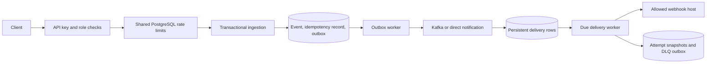

# RelayHub

RelayHub is a Java 21 / Spring Boot 4 webhook delivery project. It accepts tenant events, stores publication work in PostgreSQL, optionally routes notifications through Kafka, and delivers signed HTTP webhooks through a durable worker.

## Current architecture



Event persistence, idempotency completion, and publication intent commit together. Publication waits for Kafka acknowledgement; failed publications remain pending. Kafka processing errors are retried without silently committing failed records. Duplicate notifications reuse existing deliveries. Workers lock event rows across replicas and resume persisted pending/due deliveries after restart.

Delivery is **at least once**: if the receiver accepts a request and the sender crashes before committing the result, that request can be sent again. Receivers should deduplicate `X-RelayHub-Delivery`. Delivery completion order is not guaranteed. Virtual threads support blocking I/O; they do not make JDBC non-blocking.

## Local setup

Requirements: JDK 21, Docker Desktop, and access to Maven/container registries. The full test suite requires Docker and starts isolated PostgreSQL/Kafka containers.

```powershell
.\mvnw.cmd test
.\mvnw.cmd package -DskipTests
docker compose -f deploy/docker-compose.yml up --build -d
powershell -ExecutionPolicy Bypass -File scripts/local-demo.ps1
```

Compose is a local demo with two application instances, PostgreSQL, Kafka, an echo receiver, Prometheus and Grafana. Ports: application 8080/8081, receiver 9999, Prometheus 9090, Grafana 3000. Demo credentials and private receiver access are explicitly enabled only in Compose. Default application startup does not seed demo keys.

For a standalone application, provide database credentials, provision tenant/API-key records, and configure `RELAYHUB_WEBHOOK_ALLOWED_HOSTS` as a comma-separated list of exact destination hostnames. An empty allowlist denies all destinations. Private addresses require `RELAYHUB_WEBHOOK_ALLOW_PRIVATE_TARGETS=true`; keep this disabled outside a controlled local topology. Kafka is optional (`KAFKA_ENABLED=true` with `KAFKA_BOOTSTRAP_SERVERS`).

## Authorization and API

| API | Required role |
| --- | --- |
| Event ingestion/read; delivery audit/read | INGEST or ADMIN |
| Subscription management; API-key management; replay | ADMIN |
| Metrics and detailed actuator endpoints | ADMIN |
| Health and API documentation | Public |

Compose demo ingestion key: `rlh_live_demo1234567890abcdef`. Compose demo admin key: `rlh_admin_9876543210fedcba`. These are public demo credentials and must never be used in a public deployment.

```powershell
$headers = @{ 'X-API-Key' = 'rlh_admin_9876543210fedcba' }
Invoke-RestMethod http://localhost:8080/api/v1/subscriptions -Method Post -Headers $headers -ContentType application/json -Body '{"targetUrl":"http://mock-receiver:8080/webhook","eventTypes":"order.created"}'
$headers = @{ 'X-API-Key' = 'rlh_live_demo1234567890abcdef'; 'Idempotency-Key' = 'example-1' }
Invoke-RestMethod http://localhost:8080/api/v1/events -Method Post -Headers $headers -ContentType application/json -Body '{"eventType":"order.created","payload":{"orderId":1}}'
```

Idempotent replays return the original response/status with `Idempotent-Replay: true`. The hash binds event type and serialized payload. Mismatches return 422; a conflicting in-progress record returns 409. Completed records retain the response for 24 hours. Failed ingestion transactions roll back the lock, event and outbox work together.

## Reliability and security boundaries

- PostgreSQL serializes token and monthly-quota consumption across instances. Quotas use UTC calendar months and survive process restarts. Redis is present in the demo topology but is not used by the active limiter.
- `maxRetries` currently means **maximum total attempts**, including the first request. Transient failures and 429 responses schedule retries; other 4xx responses dead-letter immediately. Full jitter ranges from zero to the bounded exponential delay. Retry-After is capped at 24 hours.
- Attempts are preserved in `webhook_delivery_attempts`; the delivery row tracks the latest attempt. Failed/dead-lettered deliveries can be explicitly queued for replay. A manual replay grants one additional attempt after exhaustion, retaining the cumulative attempt number.
- Redirects are disabled, response previews are bounded, and destinations are checked against an operator-owned host allowlist and address restrictions at creation and delivery. Enforce outbound network policy as well: Java HTTP DNS resolution is not pinned to the policy lookup, so application validation alone is not a DNS-rebinding boundary.
- API keys are SHA-256 hashed. HMAC-SHA256 signs outbound payloads. JWT/OIDC authentication and OpenTelemetry trace propagation are not implemented.
- The initial worker is deliberately bounded and holds an event lock/database connection during each HTTP attempt. It is not a demonstrated high-throughput deployment. Tune and measure before increasing concurrency.

## Verification and deployment status

See [current fix validation](docs/FIX_VALIDATION.md) for fresh checks and limitations. [Historical evidence](docs/EVIDENCE.md) is retained separately. Existing load-test scripts are workload definitions, not current performance measurements. No managed production, Kubernetes runtime, throughput or latency claim is made by this revision.

[Architecture](docs/ARCHITECTURE.md) � [Security](docs/SECURITY.md) � [Rate limits](docs/RATE_LIMITING_SPEC.md) � [Retry/DLQ](docs/RETRY_AND_DLQ_SPEC.md) � [API](docs/API_REFERENCE.md) � [Deployment](docs/DEPLOYMENT.md)
