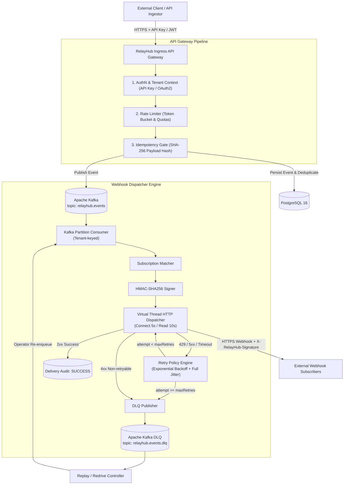
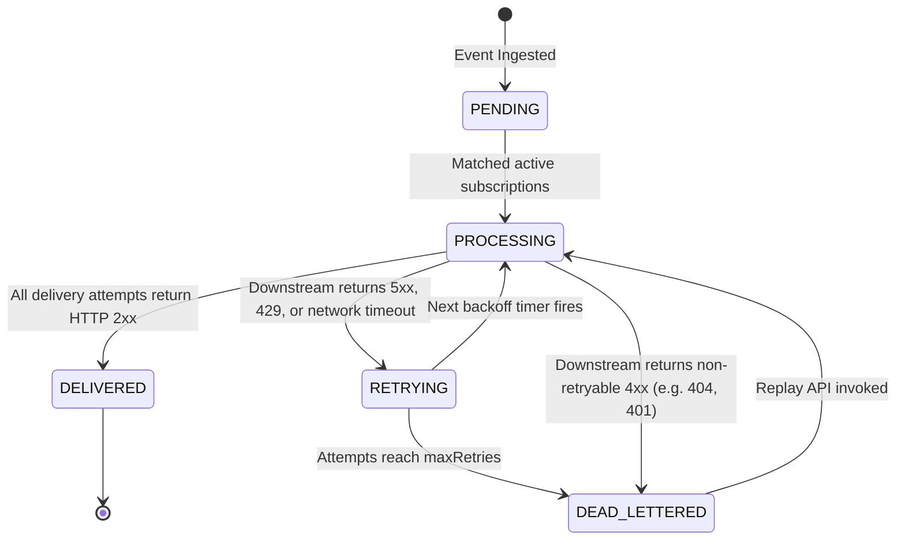

# RelayHub — Architecture & System Design

RelayHub is a high-reliability, cloud-native API Gateway & Webhook Delivery Platform designed for enterprise multi-tenant infrastructure. It decouples high-throughput ingress event ingestion from resilient, asynchronous outbound webhook delivery with strict at-least-once delivery, idempotency guarantees, and rate limit protections.

---

## 1. High-Level Architecture



---

## 2. Ingress Pipeline Breakdown

Every incoming request to `POST /api/v1/events` passes through four discrete pipeline stages:

1. **Authentication & Tenant Isolation (`ApiKeyAuthenticationFilter`)**:
   - Inspects `X-API-Key` or `Authorization: Bearer rlh_...`.
   - Computes deterministic SHA-256 hash of the key and queries `api_keys` table.
   - Verifies `is_active = TRUE` and expiration timestamp.
   - Populates `TenantContext` on the request thread.

2. **Tenant-Aware Rate Limiting & Quotas (`RateLimitFilter`)**:
   - Evaluates tenant's current token bucket and monthly consumption counter.
   - Injects standard RFC rate limiting headers: `X-RateLimit-Limit`, `X-RateLimit-Remaining`, `X-RateLimit-Reset`.
   - On limit exhaustion: sets `Retry-After: {seconds}` and immediately returns `429 Too Many Requests` formatted as an RFC 7807 `ProblemDetail`.

3. **Ingestion Idempotency Gate (`IdempotencyService`)**:
   - Reads `Idempotency-Key` header (or JSON field).
   - Computes `SHA-256(request_payload)`.
   - If key exists with matching hash and `COMPLETED`: returns previously cached response with header `Idempotent-Replay: true`.
   - If key exists with matching hash and `IN_PROGRESS`: returns `409 Conflict`.
   - If key exists with **different** hash: returns `422 Unprocessable Entity` ("Mismatched payload").
   - If key does not exist: acquires atomic lock in `idempotency_records` table with a 120-second lease.

4. **Persistence & Kafka Publishing**:
   - Persists immutable event record in `events` table with status `PENDING`.
   - Publishes `EventEnvelope` to Kafka topic `relayhub.events`.
   - Uses `tenant_id` as the Kafka message key, guaranteeing strict partition-level in-order delivery per tenant while scaling horizontally across cluster partitions.

---

## 3. Webhook Delivery Engine

The webhook dispatcher operates asynchronously with zero blocking overhead using Java 21 Virtual Threads (`Executors.newVirtualThreadPerTaskExecutor()`).

### Event Lifecycle State Machine



---

## 4. Database Schema (PostgreSQL 16)

```
+--------------------+        +---------------------+
|      tenants       |        |      api_keys       |
+--------------------+        +---------------------+
| id (PK)            |<-------| id (PK)             |
| name               |        | tenant_id (FK)      |
| tier               |        | key_prefix          |
| rate_limit_per_sec |        | key_hash (INDEX)    |
| burst_capacity     |        | role                |
| monthly_quota      |        | is_active           |
| created_at         |        | expires_at          |
+--------------------+        +---------------------+
          |
          |                   +---------------------+
          +------------------>|    subscriptions    |
          |                   +---------------------+
          |                   | id (PK)             |
          |                   | tenant_id (FK)      |
          |                   | target_url          |
          |                   | secret (HMAC)       |
          |                   | event_types         |
          |                   | is_active           |
          |                   | max_retries         |
          |                   | initial_interval_ms |
          |                   | backoff_multiplier  |
          |                   | timeout_ms          |
          |                   +---------------------+
          |
          v
+--------------------+        +----------------------+
|       events       |        |  webhook_deliveries  |
+--------------------+        +----------------------+
| id (PK)            |<-------| id (PK)              |
| tenant_id (FK)     |        | event_id (FK)        |
| event_type         |        | subscription_id (FK) |
| idempotency_key    |        | attempt_number       |
| payload (TEXT/JSON)|        | status               |
| status             |        | http_status          |
| created_at         |        | request_headers      |
+--------------------+        | response_body        |
                              | latency_ms           |
                              | next_retry_at        |
                              +----------------------+
```
